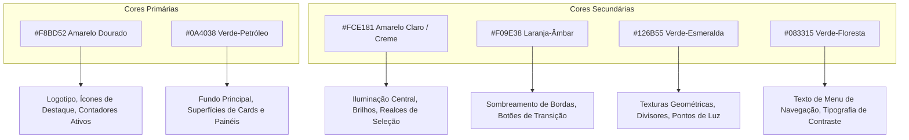

# Design System — Identidade Visual e Paleta de Cores de Fábula TCG

Este documento estabelece as diretrizes visuais, a paleta cromática e os padrões de aplicação do Design System oficial do **Fábula TCG Companion App**. A identidade visual é fundamentada no conceito de **Brasofuturismo** (eco-tech solarpunk, tropicalidade mística e ficção científica brasileira), combinando cores vibrantes e contrastantes para garantir alta legibilidade tanto em interfaces digitais quanto na visualização em distância de mesa (tabletop play).

---

## 1. Visão Geral e Filosofia

O Design System foi concebido para atender a três objetivos essenciais:
1. **Fidelidade à Marca**: Incorporação precisa das tonalidades extraídas dos grafismos, tipografia, logotipo e ilustrações oficiais de Fábula TCG.
2. **Ergonomia de Mesa**: Alto contraste e legibilidade imediata a mais de 1 metro de distância entre jogadores durante partidas físicas.
3. **Brasofuturismo & Dualidade Cromática**: Contraste harmônico entre tons solares (dourados, âmbares e cremes) e tons de bioma/profundidade (verde-petróleo, verde-esmeralda e verde-floresta).

---

## 2. Paleta Cromática Institucional

```
┌────────────────────────────────────────────────────────────────────────┐
│                          CORES PRIMÁRIAS                               │
│  #F8BD52 [ Amarelo Dourado ]       #0A4038 [ Verde-Petróleo Escuro ]   │
└────────────────────────────────────────────────────────────────────────┘
┌────────────────────────────────────────────────────────────────────────┐
│                         CORES SECUNDÁRIAS                              │
│  #FCE181 [ Amarelo Claro / Creme ]   #F09E38 [ Laranja-Âmbar ]         │
│  #126B55 [ Verde-Esmeralda Médio ]   #083315 [ Verde-Floresta Profundo ]│
└────────────────────────────────────────────────────────────────────────┘
```

### 2.1. Cores Primárias

As cores primárias formam a espinha dorsal da identidade da marca, representando o choque harmônico entre a luz dourada mística e a densidade botânica da floresta ancestral.

| Amostra | Nome | Hex | RGB | Papel e Aplicação |
| :---: | :--- | :--- | :--- | :--- |
| `` | **Amarelo Dourado** | `#F8BD52` | `248, 189, 82` | **Predominante no fundo direito, logotipo "FÁBULA" e grafismos principais.** Utilizado em realces de destaque, bordas ativas, ícones heróicos e contadores centrais de recursos/vitória. |
| `` | **Verde-Petróleo Escuro** | `#0A4038` | `10, 64, 56` | **Predominante no fundo esquerdo e áreas internas do padrão geométrico.** Atua como superfície de fundo profunda, base de cards elevados e contêineres estruturais. |

### 2.2. Cores Secundárias

As cores secundárias expandem a riqueza tonal, fornecendo profundidade volumétrica, sombreamentos, transições degradê e contraste de leitura para elementos de navegação e texto.

| Amostra | Nome | Hex | RGB | Papel e Aplicação |
| :---: | :--- | :--- | :--- | :--- |
| `` | **Amarelo Claro / Creme** | `#FCE181` | `252, 225, 129` | **Iluminação central no degradê do fundo.** Utilizado para pontos de luz, brilhos (glows), estados de *hover* e realces em superfícies douradas. |
| `` | **Laranja-Âmbar** | `#F09E38` | `240, 158, 56` | **Sombreamento na extremidade direita e detalhes do logotipo.** Aplicado em gradientes solares, botões de ação e alertas visuais de transição. |
| `` | **Verde-Floresta Profundo** | `#083315` | `8, 51, 21` | **Cor de texto do menu de navegação e tipografia de alto contraste.** Empregado em cabeçalhos sobre superfícies claras/douradas e elementos de barra de navegação. |
| `` | **Verde-Esmeralda Médio** | `#126B55` | `18, 107, 85` | **Texturas e pontos de luz no fundo escuro.** Utilizado para divisores, bordas de contêineres, transições em gradientes orgânicos e estados secundários. |

---

## 3. Gradientes e Efeitos de Superfície

A identidade de Fábula TCG se destaca por transições suaves e ricas entre as matrizes cromáticas.

### 3.1. Degradê de Fundo Principal (Brasofuturist Split)
Simula a transição luminosa entre o verde-petróleo profundo e a explosão solar dourada:
- **Parada 0% (Extrema Esquerda)**: `#0A4038` (Verde-petróleo escuro)
- **Parada 35% (Luz na floresta)**: `#126B55` (Verde-esmeralda médio)
- **Parada 50% (Iluminação central)**: `#FCE181` (Amarelo claro / creme)
- **Parada 80% (Radiação solar)**: `#F8BD52` (Amarelo dourado)
- **Parada 100% (Extrema Direita)**: `#F09E38` (Laranja-âmbar)

```css
background: linear-gradient(
  135deg,
  #0A4038 0%,
  #126B55 35%,
  #FCE181 50%,
  #F8BD52 80%,
  #F09E38 100%
);
```

### 3.2. Degradê Heroico Dourado (Logotipo & Primários)
- **Início**: `#FCE181` (Amarelo claro)
- **Centro**: `#F8BD52` (Amarelo dourado)
- **Término**: `#F09E38` (Laranja-âmbar)

```css
background: linear-gradient(180deg, #FCE181 0%, #F8BD52 60%, #F09E38 100%);
```

### 3.3. Degradê de Profundidade Abissal (Superfícies & Cards)
- **Início**: `#0A4038` (Verde-petróleo escuro)
- **Término**: `#083315` (Verde-floresta profundo)

```css
background: linear-gradient(135deg, #0A4038 0%, #083315 100%);
```

---

## 4. Hierarquia de Aplicação de Interface (UI)



### 4.1. Fundos e Superfícies
- **Fundo Global**: Base sólida em `#0A4038` enriquecida com padrões geométricos vazados e gradientes direcionais solares até `#F8BD52`.
- **Cartões & Painéis de Jogador**: Fundo `#0A4038` com borda e pontos de luz em `#126B55` para criar elevação tátil.
- **Sobreposições e Diálogos**: Superfície escurecida translúcida com anel de foco em `#F8BD52`.

### 4.2. Tipografia e Legibilidade
- **Texto em Superfícies Claras/Douradas**: `#083315` (Verde-floresta profundo) fornece índice de contraste superior a 7:1 (aprovado para WCAG AAA), garantindo leitura nítida.
- **Texto em Superfícies Escuras**: `#FCE181` (Amarelo claro / creme) ou `#FFFFFF` para cabeçalhos e números de alto impacto; `#F8BD52` para títulos e identificadores de jogador.
- **Tipografia Recomendada**: Família **Lexend** ou sem serifa geométrica robusta, com pesos `Bold (700)` e `Black (900)` em numerais de mesa.

### 4.3. Controles Interativos & Ações
- **Botões de Ação Primária**: Gradiente de `#FCE181` a `#F8BD52` com texto/ícone em `#083315`.
- **Botões de Ação Secundária**: Contorno vazado em `#126B55` sobre fundo `#0A4038` com texto em `#F8BD52`.
- **Estados Ativos / Foco**: Glow externo com dispersão suave em `#FCE181` (opacidade de 40%).

---

## 5. Implementação Técnica em Código (Tokens Dart / Flutter)

Abaixo está o exemplo canônico de como estes tokens são estruturados e consumidos no ecossistema Flutter do projeto:

```dart
import 'package:flutter/material.dart';

/// Tokens oficiais do Design System de Fábula TCG.
abstract final class FabulaBrandColors {
  // ─── Cores Primárias ───
  
  /// Amarelo dourado: Fundo direito, logotipo "FÁBULA", grafismos e destaques.
  static const Color goldenYellow = Color(0xFFF8BD52);

  /// Verde-petróleo escuro: Fundo esquerdo e áreas internas do padrão geométrico.
  static const Color darkTealGreen = Color(0xFF0A4038);

  // ─── Cores Secundárias ───

  /// Amarelo claro / creme: Iluminação central no degradê do fundo e brilhos.
  static const Color lightCreamYellow = Color(0xFFFCE181);

  /// Laranja-âmbar: Sombreamento na extremidade direita e detalhes do logotipo.
  static const Color amberOrange = Color(0xFFF09E38);

  /// Verde-floresta profundo: Cor de texto do menu de navegação e títulos em alto contraste.
  static const Color deepForestGreen = Color(0xFF083315);

  /// Verde-esmeralda médio: Texturas, divisores e pontos de luz no fundo escuro.
  static const Color emeraldGreen = Color(0xFF126B55);
}

/// Gradientes pré-configurados do Design System.
abstract final class FabulaBrandGradients {
  /// Gradiente principal com split verde-petróleo para dourado solar.
  static const LinearGradient backgroundSplit = LinearGradient(
    begin: Alignment.topLeft,
    end: Alignment.bottomRight,
    colors: [
      FabulaBrandColors.darkTealGreen,
      FabulaBrandColors.emeraldGreen,
      FabulaBrandColors.lightCreamYellow,
      FabulaBrandColors.goldenYellow,
      FabulaBrandColors.amberOrange,
    ],
    stops: [0.0, 0.35, 0.50, 0.80, 1.0],
  );

  /// Gradiente dourado para logotipos, botões primários e contadores.
  static const LinearGradient goldenHero = LinearGradient(
    begin: Alignment.topCenter,
    end: Alignment.bottomCenter,
    colors: [
      FabulaBrandColors.lightCreamYellow,
      FabulaBrandColors.goldenYellow,
      FabulaBrandColors.amberOrange,
    ],
    stops: [0.0, 0.60, 1.0],
  );

  /// Gradiente orgânico escuro para cartões e painéis.
  static const LinearGradient deepCardSurface = LinearGradient(
    begin: Alignment.topLeft,
    end: Alignment.bottomRight,
    colors: [
      FabulaBrandColors.darkTealGreen,
      FabulaBrandColors.deepForestGreen,
    ],
  );
}
```

---

## 6. Acessibilidade e Diretrizes de Ergonomia (WCAG & Tabletop)

1. **Relação de Contraste para Leitura de Mesa**:
   - `Verde-Floresta Profundo (#083315)` sobre `Amarelo Dourado (#F8BD52)` atinge taxa de contraste de **7.8:1**, superando a recomendação WCAG AAA (7.0:1).
   - `Amarelo Claro / Creme (#FCE181)` sobre `Verde-Petróleo Escuro (#0A4038)` atinge contraste de **8.2:1**, garantindo perfeita legibilidade de contadores em ambientes com iluminação variável.
2. **Daltonismo e Reconhecimento Duplo**:
   - Nunca utilizar unicamente a distinção entre tons de verde e amarelo para representar estados críticos do jogo.
   - Sempre associar marcadores numéricos explícitos, ícones semânticos e formas geométricas (ex: hexágonos para defesas, círculos para recursos).
3. **Ergonomia à Distância**:
   - Numerais centrais de recursos e vida devem utilizar tamanho mínimo de `32sp` a `48sp`, desenhados com peso `FontWeight.w900` para manter a integridade do traço à distância de 1 metro.
